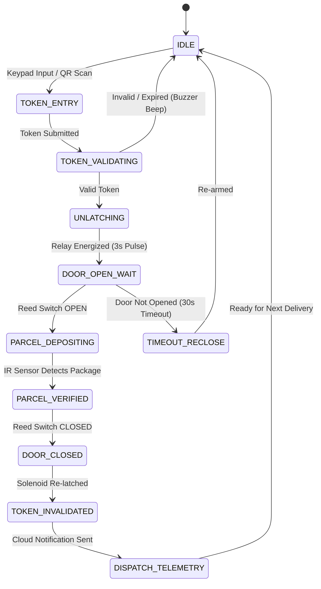

# HULOG System Architecture & Technical Specification

This document provides a comprehensive technical breakdown of the **HULOG IoT-Enabled Dynamic QR Parcel Drop Vault**, including the real-time embedded state machine, dual-core FreeRTOS task partition, security threat model, and end-to-end data communication loop.

---

## 🏛️ High-Level System Architecture

```text
┌────────────────────────────────────────────────────────────────────────┐
│                          CLOUD / WEB LAYER                             │
│                                                                        │
│   Recipient Mobile Portal        Courier Web Scanner                   │
│   (Issue Dynamic PIN / QR)       (Scan QR / Enter PIN)                 │
│              │                               │                         │
│              └───────────────┬───────────────┘                         │
│                              ▼                                         │
│                 REST API / MQTT Cloud Broker                           │
│               (Token Minting, State Sync, Auth)                        │
└──────────────────────────────┬─────────────────────────────────────────┘
                               │ (TLS Encrypted Wi-Fi / MQTT)
                               ▼
┌────────────────────────────────────────────────────────────────────────┐
│                        ESP32 EDGE DEVICE                               │
│                                                                        │
│   ┌───────────────────────────────────┬────────────────────────────┐   │
│   │   Core 0: Network & Security      │  Core 1: Real-Time Control │   │
│   ├───────────────────────────────────┼────────────────────────────┤   │
│   │ • Wi-Fi 802.11 b/g/n Manager      │ • Keypad Matrix Scanner    │   │
│   │ • MQTT / HTTP Client              │ • Solenoid Relay Actuator  │   │
│   │ • Dynamic Token Validation Engine │ • Door Limit Switch ISR    │   │
│   │ • SPIFFS Offline Flash Cache      │ • IR Optical Presence ISR  │   │
│   │ • Telegram Notification Dispatcher│ • SSD1306 OLED Rendering   │   │
│   └───────────────────────────────────┴────────────────────────────┘   │
│                                │                                       │
│                                ▼                                       │
│                       HARDWARE ACTUATION                               │
│        [12V Solenoid] ◄── [Relay] ◄── [Sensor Interlock]               │
└────────────────────────────────────────────────────────────────────────┘
```

---

## 🔄 Closed-Loop Operational State Machine

To prevent theft, accidental open locks, or unverified deposits, HULOG operates on a deterministic, closed-loop state machine. A single delivery transaction strictly transitions through the following phases:



### Detailed State Descriptions
1. **`STATE_IDLE`:** Vault door is mechanically latched. OLED displays idle status screen with live clock and "Scan QR or Enter Code". FreeRTOS tasks idle in power-efficient sleep ticks.
2. **`STATE_TOKEN_ENTRY`:** Courier enters 6-digit numeric PIN on the 4x4 membrane keypad or scans the dynamic QR code via the courier portal.
3. **`STATE_TOKEN_VALIDATING`:** The token is matched against the local active token table (synchronized from the web cloud or verified locally via pre-shared TOTP hash). 
   - If invalid: Buzzer emits 3 warning pulses; failed attempt counter increments. (3 consecutive failures trigger a 5-minute lockout).
   - If valid: Transition to `STATE_UNLATCHING`.
4. **`STATE_UNLATCHING`:** ESP32 pulls GPIO 23 LOW for exactly 3,000ms, energizing the 5V relay coil. The 12V solenoid retracts its spring-loaded plunger. OLED displays `"ACCESS GRANTED — OPEN DOOR"`.
5. **`STATE_DOOR_OPEN_WAIT`:** A 30-second countdown initiates. The magnetic reed switch on GPIO 19 monitors door physical separation.
   - If door is opened: Solenoid is de-energized to prevent overheating. State transitions to `STATE_PARCEL_DEPOSITING`.
   - If door is never opened: After 30 seconds, token is placed on hold or re-locked, returning to `STATE_IDLE`.
6. **`STATE_PARCEL_DEPOSITING`:** The internal optical IR presence sensor (GPIO 18) continuously evaluates the drop tray. When the courier places the package inside, the infrared beam breaks, asserting `STATE_PARCEL_VERIFIED`.
7. **`STATE_DOOR_CLOSED`:** Courier closes the door. The magnetic reed switch detects contact (GPIO 19 goes LOW). The heavy-duty angled latch clicks shut mechanically.
8. **`STATE_TOKEN_INVALIDATED`:** The active token is marked as `CONSUMED` permanently in local SPIFFS flash memory and signaled to the cloud broker. The token can never be reused.
9. **`STATE_DISPATCH_TELEMETRY`:** ESP32 dispatches a structured MQTT delivery receipt to the recipient's dashboard and triggers a Telegram Bot notification with an exact timestamp and deposit verification log.

---

## ⚡ FreeRTOS Dual-Core Task Partitioning

The ESP32 features a dual-core 32-bit Xtensa LX6 processor. HULOG assigns tasks to separate cores to guarantee deterministic real-time hardware response regardless of network latency:

### Core 1: Hardware Control & Real-Time Sensors
- **Priority 3 (High):** `vTaskHardwareISR` — Debounced interrupt service routines for the magnetic reed switch and optical IR sensor.
- **Priority 2 (Medium):** `vTaskKeypadScan` — 20ms matrix polling loop for the 4x4 membrane keypad with multi-key rollover suppression.
- **Priority 1 (Low):** `vTaskDisplayManager` — OLED screen rendering (SSD1306 128x64) via hardware I2C at 400kHz.

### Core 0: Networking, Security, & Storage
- **Priority 2 (Medium):** `vTaskNetworkSync` — Maintains 802.11b/g/n Wi-Fi connection, auto-reconnects with exponential backoff, and listens on MQTT topics.
- **Priority 2 (Medium):** `vTaskTokenManager` — Cryptographic hash validation, dynamic token expiry timer management, and brute-force lockout timers.
- **Priority 1 (Low):** `vTaskFlashStorage` — Read/write access to non-volatile SPIFFS flash memory for offline transaction buffering.

---

## 🛡️ Security & Threat Model Analysis

| Attack Vector | Threat Scenario | HULOG Countermeasure |
| :--- | :--- | :--- |
| **Replay Attacks** | Courier or bystander photos a used QR code or copies a 6-digit PIN to reuse it later. | **Single-Cycle Invalidation:** Every token is cryptographically bound to a unique UUID and automatically destroyed the instant the reed switch confirms door reclosure. |
| **Brute-Force PIN Entry** | An attacker randomly inputs 6-digit combinations on the physical keypad. | **Exponential Lockout & Audible Alarm:** 3 incorrect attempts trigger a 5-minute keypad lockout, a loud buzzer alarm, and an immediate tamper warning sent to the owner's phone. |
| **Power Loss / Brownout** | Grid power is severed or wires are cut from the exterior. | **Fail-Secure Default:** The solenoid lock is mechanically spring-loaded closed. Loss of power leaves the vault securely locked. An optional 12V SLA battery backup provides 48-hour continuous runtime. |
| **Network Outage / Offline** | Home Wi-Fi disconnects during delivery. | **Local TOTP Fallback & SPIFFS Caching:** The ESP32 maintains an onboard time-based OTP engine synchronized with pre-shared keys. Delivery events are stored in offline flash memory and flushed to the cloud upon reconnection. |
| **Physical Tampering** | Unauthorized forced entry / prying the door open. | **Sensor Trip Alarm:** If the magnetic reed switch triggers (door opens) without an approved authentication event in the state machine, an immediate tamper alarm is logged and signaled. |
